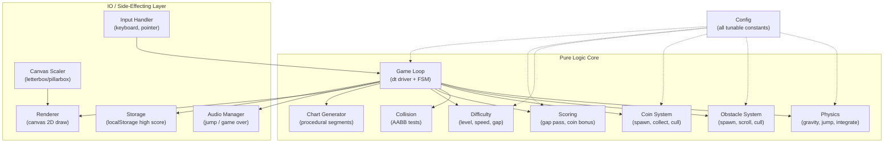
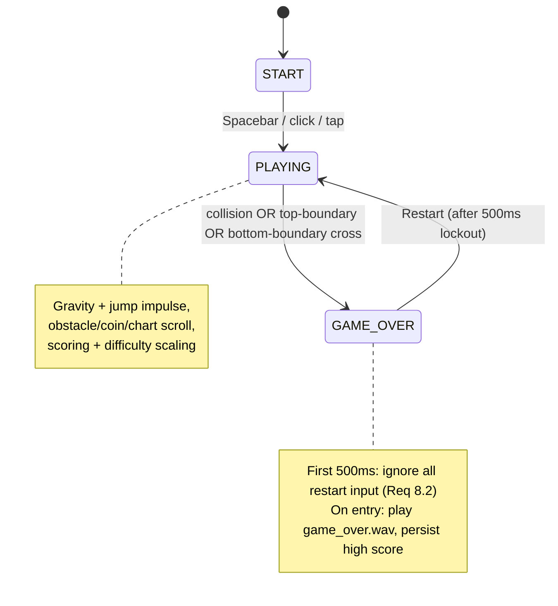

# Design Document

## Overview

Flappy Kiro is a single-file, dependency-free browser game built with plain HTML, CSS, and JavaScript rendering to an HTML5 `<canvas>`. The entire game ships in one `index.html` that runs directly from the `file://` protocol with no server, no build step, and no external network calls. All game assets (sprite, audio) are loaded via local relative paths from the `assets/` directory.

The game is a retro endless-scroller with a trading/finance theme. The player taps Spacebar or clicks/taps the canvas to make Ghosty (a ghost sprite) fly up against gravity, threading through candlestick-style obstacle pairs on a live-scrolling stock-chart background. Profit (the score) increases by passing gaps and collecting coins, and "market volatility" (difficulty) scales up as Profit grows. The best run is persisted to `localStorage`.

### Design Goals

- **Zero-install, zero-dependency:** one HTML file, local assets, opens directly in any current stable browser.
- **Deterministic, testable core:** pure functions for physics, collision, scoring, difficulty, and spawn logic so they can be validated with property-based tests independent of the DOM/canvas.
- **Frame-rate independence:** all motion driven by delta-time in seconds, with a clamped maximum step.
- **Visual cohesion:** a single trading/finance palette and typography system applied across all three screens.

### Key Design Decisions

| Decision | Rationale |
|---|---|
| Single `index.html` with inline `<style>` and `<script>` | Requirement 1.1 mandates no build step and `file://` operation. Inlining avoids module-loading issues under `file://` (ES module CORS restrictions). |
| Fixed logical resolution 800×600, CSS-scaled | Requirement 13.5 — all layout math uses stable logical coordinates; the canvas backing store stays 800×600 while CSS scales it with letterbox/pillarbox. |
| Pure logic functions separated from rendering/IO | Enables property-based testing (Requirements map to Correctness Properties) and keeps the game loop thin. |
| Delta-time integration, dt capped at 100 ms | Requirement 14 — consistent speed on 60 Hz and 144 Hz, no teleporting after tab-switch stalls. |
| Explicit finite-state machine (`START` / `PLAYING` / `GAME_OVER`) | Requirements 2, 7, 8 — clean transitions, input gating, and the 500 ms restart lockout. |
| Central `Config` object | Requirements 1.3, 3.6, 6.6, 10.3, 14.2 — one place for every tunable constant. |

---

## Architecture

### High-Level Structure

Although the game is physically one file, it is logically organized into cohesive modules (IIFE-scoped namespaces or plain object groupings inside the single script). The split follows a clear boundary: **pure logic** (no DOM, no canvas, no audio, fully unit/property testable) versus **IO/rendering** (canvas draw calls, audio playback, input listeners, localStorage).



### Game Loop

The loop uses `requestAnimationFrame`. Each frame:

1. Compute raw `dt = (now - lastTime) / 1000` in seconds.
2. Clamp `dt = min(dt, Config.maxDeltaTime)` where `maxDeltaTime = 0.1` s (Requirement 14.3).
3. `update(dt, state)` — a pure-ish step that advances physics, obstacles, coins, scoring, difficulty, and chart. All velocities are multiplied by `dt`.
4. `render(ctx, state)` — draws the current state for the active screen.
5. Store `lastTime = now`, request the next frame.

Update and render are dispatched by the current FSM state so that, e.g., physics only advances in `PLAYING`.

```mermaid
sequenceDiagram
    participant RAF as requestAnimationFrame
    participant Loop as Game Loop
    participant Core as Pure Update
    participant Render as Renderer
    RAF->>Loop: timestamp(now)
    Loop->>Loop: dt = min((now-last)/1000, 0.1)
    Loop->>Core: update(dt, state) [if PLAYING]
    Core-->>Loop: nextState
    Loop->>Render: render(ctx, nextState)
    Loop->>RAF: request next frame
```

### State Machine



- `START`: static screen, waits indefinitely for first input (Requirement 2.5). First input → `PLAYING`.
- `PLAYING`: full simulation runs. Any collision or boundary cross → `GAME_OVER` in the same frame (Requirement 7.1–7.3).
- `GAME_OVER`: on entry, update/persist high score and play game-over audio. Restart input is ignored for 500 ms (Requirement 8.2); after that, a valid restart resets state and enters `PLAYING` directly (Requirement 8.7) — there is no return to `START`.

While in `GAME_OVER`, further collision/boundary events are ignored (Requirement 7.6) because the update step for physics/collision no longer runs in that state.

---

## Components and Interfaces

All functions in the **Pure Logic Core** are written to take explicit inputs and return new values (no hidden global reads), which is what makes them property-testable. Signatures below are descriptive (JSDoc-style) since the implementation is plain JavaScript.

### Config

A single frozen object defining every tunable constant. See the Data Models section for its full shape.

### Physics

```js
// Apply gravity and integrate vertical motion for one frame.
// Returns new { y, vy }. Pure.
integratePlayer(player, dt, config) -> { y, vy }

// Apply a single upward impulse (unconditional while PLAYING). Pure.
applyJump(player, config) -> { y, vy }   // vy = -config.jumpImpulse
```

Gravity is added to `vy` as `vy + gravity * dt`; position as `y + vy * dt` (Requirements 3.2, 14.1–14.2). Jump sets `vy` to the upward impulse regardless of current velocity (Requirement 3.3–3.4).

### Hitbox / Geometry

```js
// Ghosty's collision rect: 80% of the rendered sprite size, centered. Pure.
// Rendered size comes from Config (spriteWidth/spriteHeight), NOT the PNG's
// natural dimensions, so the hitbox is 0.8*Config.spriteWidth × 0.8*Config.spriteHeight.
playerHitbox(player, config) -> { x, y, w, h }   // Req 3.7

// Axis-aligned bounding-box overlap test. Pure.
aabbIntersect(a, b) -> boolean                    // Req 7.1, 6.3
```

Ghosty's sprite is always drawn at `Config.spriteWidth` × `Config.spriteHeight` — the `assets/ghosty.png` image is scaled to that fixed size regardless of its natural pixel dimensions. Ghosty's x is fixed at `0.2 * CANVAS_W` (Requirements 3.1, 3.5); the hitbox is centered on the sprite and sized to 80% of the Config-defined rendered dimensions (`0.8 * Config.spriteWidth` wide × `0.8 * Config.spriteHeight` tall), independent of the PNG's natural size.

### Obstacle System

```js
// Create one obstacle pair at x = CANVAS_W with a random gap center. Pure
// given an injected RNG. The new gap center is first constrained to lie within
// at most Config.maxGapDelta (180 px) vertical distance of the PREVIOUS
// obstacle's gap center (prevGapCenterY), then clamped to the valid on-canvas
// range [gapSize/2, canvasHeight - gapSize/2] so both pillars stay fully
// on-canvas (Req 4.6) and every gap remains reachable from the previous one.
spawnObstacle(config, gapSize, prevGapCenterY, rng) -> Obstacle

// Advance all obstacles left by speed*dt and drop any fully off-screen
// (right edge <= 0). Pure. Returns new obstacle array. Req 4.3, 4.4
updateObstacles(obstacles, dt, speed) -> Obstacle[]

// Whether it's time to spawn based on accumulated time vs interval. Req 4.7
shouldSpawn(elapsedSinceLastSpawn, config) -> boolean
```

Each obstacle carries both pillar rects plus a `passed` flag used by scoring. Rendering draws the candlestick body + wick (top red, bottom green — Requirement 4.2).

### Coin System

```js
// With probability config.coinSpawnChance (via injected rng), attach a coin
// at the gap's horizontal/vertical midpoint. Req 6.1, 6.2
maybeSpawnCoin(obstacle, config, rng) -> Coin | null

// Collect coin if player hitbox overlaps it; returns { coin, collected }.
// Req 6.3, 6.4
tryCollectCoin(playerBox, coin) -> boolean
```

Coins move with their owning obstacle and are culled when the obstacle leaves the screen (Requirement 6.5).

### Collision & Boundaries

```js
// Returns true if player hitbox intersects any pillar of any obstacle. Req 7.1
hitsAnyObstacle(playerBox, obstacles) -> boolean

// Returns 'top' | 'bottom' | null for canvas boundary crossings. Req 7.2, 7.3
boundaryCross(playerBox, canvasHeight) -> 'top' | 'bottom' | null
```

### Scoring

```js
// For each obstacle whose gap right-edge the player has just crossed and
// which isn't already counted, increment profit by 1 and mark passed.
// Counts each pair at most once (Req 5.1). Returns { profit, obstacles }.
scoreGapPasses(profit, obstacles, playerX) -> { profit, obstacles }

// Add coin bonus to profit (Req 6.3, 6.6)
addCoinBonus(profit, config) -> number   // profit + config.coinBonus
```

### Difficulty (Market Volatility)

```js
// Difficulty level = floor(profit / volatilityStep). Req 10.1
difficultyLevel(profit, config) -> number

// Given a level, compute scroll speed and gap size, clamped. Because this is
// a pure function of level (not incremental state), no level is ever skipped
// even when a coin bonus jumps profit past several thresholds. Req 10.2
speedForLevel(level, config) -> number   // min(initialSpeed + level*speedIncrement, maxSpeed)
gapForLevel(level, config)   -> number   // max(initialGap - level*gapReduction, minGap)
```

Deriving speed and gap as closed-form functions of the level (rather than mutating on each threshold crossing) is the key decision that guarantees Requirement 10.2's "no level ever skipped" even under a multi-level coin jump.

### Chart Generator (Background)

```js
// Append new procedural chart segments so the right edge is always covered,
// scroll existing segments left by speed*dt, cull off-screen segments.
// jaggedness/amplitude scales with difficulty level. Req 11, 13.7
updateChart(segments, dt, speed, level, config, rng) -> Segment[]
```

Rendered with the Canvas 2D API only (no image assets), dark background, green for up-moves and red for down-moves (Requirement 11.5).

### IO Layer (not property-tested)

```js
InputHandler  // binds keydown(Space) + pointerdown; routes intent to the FSM (see below)
Renderer      // draws start/playing/gameover screens for current state
AudioManager  // play('jump'|'gameover'), restart-from-start for jump, safe failure
Storage       // getHighScore() / setHighScore(n) with try/catch around localStorage
CanvasScaler  // sets CSS size to fit viewport preserving 800:600, letterbox/pillarbox
```

### InputHandler behavior

- **Prevent page scroll:** on Spacebar `keydown`, call `event.preventDefault()` so the browser does not scroll the page on space.
- **Ignore auto-repeat:** when `event.repeat` is `true` (a held-down key firing repeatedly), the event is dropped. A held key therefore produces at most one action per physical press, never a continuous stream of jumps.
- **One input → exactly one action, chosen by FSM state:** the handler routes each accepted input to a single action based on the current state, so a single event never both starts/restarts a run and applies a jump:
  - `START`: the input starts a run (transition to `PLAYING`) and does **not** apply a jump impulse.
  - `GAME_OVER`: once the 500 ms lockout has elapsed, the input restarts the run (reset + transition to `PLAYING`) and does **not** apply a jump impulse; during the lockout it is ignored entirely.
  - `PLAYING`: only here does the input apply an upward jump impulse (Requirements 3.3, 3.4).
- Consequently the event that transitions out of `START` or `GAME_OVER` is "consumed" by the transition; the first actual jump requires a subsequent input received while already in `PLAYING`.

### AudioManager behavior

- `jump`: reset `currentTime = 0` then `play()` so rapid taps restart the sound (Requirement 12.1).
- `gameover`: play on `GAME_OVER` entry (Requirements 7.4, 12.2).
- Autoplay policy: if `play()` rejects before first user gesture, queue and retry on the first keypress/pointer event (Requirement 12.3).
- All `play()` promise rejections and load errors are caught and swallowed — no dialog, no UI change, gameplay continues (Requirements 7.5, 12.4, 12.5).

### Storage behavior

- `getHighScore()`: read key, parse int; missing/invalid → `0` (Requirements 9.2, 9.3).
- `setHighScore(n)`: write only if `n` exceeds stored value; wrap in `try/catch` so a write failure keeps the value in memory for the session and surfaces no error (Requirements 9.1, 9.4).

---

## Data Models

### Config

```js
const Config = Object.freeze({
  // --- Canvas (logical resolution) ---
  canvasWidth: 800,          // px  (Req 13.5)
  canvasHeight: 600,         // px  (Req 13.5)

  // --- Physics (per-second units, Req 14.2) ---
  gravity: 1600,             // px/s^2 downward          (Req 1.3, 3.2)
  jumpImpulse: 480,          // px/s upward (applied as vy = -jumpImpulse) (Req 3.3)
  maxDeltaTime: 0.1,         // s  (clamp)               (Req 14.3)

  // --- Player (Ghosty) ---
  playerXRatio: 0.20,        // fixed at 20% canvas width (Req 3.1, 3.5)
  playerStartYRatio: 0.50,   // 50% canvas height         (Req 3.1)
  hitboxScale: 0.80,         // 80% of sprite w/h         (Req 3.7)
  spriteWidth: 48,           // px — rendered Ghosty width (image scaled to this regardless of PNG natural size)
  spriteHeight: 48,          // px — rendered Ghosty height

  // --- Scroll speed / difficulty (Req 10.3) ---
  initialSpeed: 180,         // px/s                      (Req 1.3)
  speedIncrement: 15,        // px/s per level
  maxSpeed: 360,             // px/s
  volatilityStep: 10,        // profit interval per level (Req 10.1)

  // --- Obstacles / gaps (Req 10.3) ---
  initialGap: 200,           // px                        (Req 1.3, 4.5)
  gapReduction: 8,           // px per level
  minGap: 130,               // px
  maxGapDelta: 180,          // px — max vertical gap-center change between consecutive obstacles
  obstacleWidth: 70,         // px
  wickWidth: 8,              // px (candlestick wick)
  spawnInterval: 1.6,        // s between obstacle pairs  (Req 1.3, 4.7)

  // --- Coins (Req 6.6) ---
  coinBonus: 5,              // profit added on collect
  coinSpawnChance: 0.5,      // probability per gap       (Req 6.1)
  coinRadius: 14,            // px

  // --- Restart ---
  restartLockoutMs: 500,     // input-ignore window       (Req 8.2)

  // --- Theme / UI (Req 13) ---
  minFontSize: 14,           // px                        (Req 13.2)
  palette: {
    bg:   '#0b0e14',         // dark background
    up:   '#16c784',         // green (positive)
    down: '#ea3943',         // red (negative)
    text: '#e6e8ec',         // light text on dark
    gold: '#f5c542',         // coin
  },
});
```

### Runtime State

```js
GameState = {
  screen: 'START' | 'PLAYING' | 'GAME_OVER',
  player: Player,
  obstacles: Obstacle[],
  chart: Segment[],
  profit: number,            // current session score (Req 5)
  highScore: number,         // from localStorage (Req 9)
  level: number,             // difficulty level (Req 10)
  speed: number,             // current scroll speed px/s
  gapSize: number,           // current gap px
  spawnTimer: number,        // s since last obstacle spawn
  gameOverAt: number | null, // timestamp of GAME_OVER entry (for 500ms lockout)
}
```

```js
Player = {
  y: number,     // vertical center position (px)
  vy: number,    // vertical velocity (px/s)
  // x is derived: Config.playerXRatio * Config.canvasWidth
  spriteW: number,   // = Config.spriteWidth  (PNG scaled to this; not the image's natural width)
  spriteH: number,   // = Config.spriteHeight (PNG scaled to this; not the image's natural height)
}
```

```js
Obstacle = {
  x: number,              // left edge (px), moves right -> left
  gapCenterY: number,     // px, constrained per Req 4.6
  gapSize: number,        // px at spawn time
  width: number,          // Config.obstacleWidth
  passed: boolean,        // scored flag (Req 5.1)
  coin: Coin | null,      // optional (Req 6.1)
}
// Derived pillar rects:
//   top:    { x, y: 0,                      w: width, h: gapCenterY - gapSize/2 }
//   bottom: { x, y: gapCenterY + gapSize/2, w: width, h: canvasHeight - (gapCenterY + gapSize/2) }
```

```js
Coin = {
  x: number,    // gap horizontal midpoint
  y: number,    // gap vertical midpoint
  r: number,    // Config.coinRadius
  collected: boolean,
}
```

```js
Segment = {
  points: {x, y}[],   // procedural price path for this chart chunk
  dir: 'up' | 'down', // color selection (green/red) per sub-move
}
```

### localStorage Schema

- Key: `flappyKiro.highScore`
- Value: stringified non-negative integer. Absent/invalid → treated as `0` (Requirement 9.3).

---

## Correctness Properties

*A property is a characteristic or behavior that should hold true across all valid executions of a system — essentially, a formal statement about what the system should do. Properties serve as the bridge between human-readable specifications and machine-verifiable correctness guarantees.*

These properties target the **Pure Logic Core** (physics, geometry, obstacle/coin/difficulty/scoring/chart/scaler functions), which take explicit inputs and return new values, making them suitable for property-based testing with injected randomness and mocked IO. Rendering content, audio side effects, cross-browser behavior, and performance are validated by example/integration/smoke tests in the Testing Strategy instead.

After prework, redundant criteria were consolidated: the Spacebar and click/tap jumps (3.3/3.4) share one property; coin collection and removal (6.3/6.4) are one property; high-score update and persistence condition (8.5/9.1) are one property.

### Property 1: Jump applies the configured upward impulse

*For any* player vertical velocity, applying a jump sets the vertical velocity to `-Config.jumpImpulse` regardless of the prior velocity and regardless of whether the input was Spacebar or click/tap.

**Validates: Requirements 3.3, 3.4**

### Property 2: Gravity integration

*For any* player and any delta time `dt` in `(0, Config.maxDeltaTime]`, one integration step increases vertical velocity by exactly `Config.gravity * dt` and advances position by `vy * dt`.

**Validates: Requirements 3.2, 14.1, 14.2**

### Property 3: Horizontal position is invariant

*For any* game state and any canvas width, Ghosty's derived horizontal position equals `Config.playerXRatio * width`.

**Validates: Requirements 3.5**

### Property 4: Hitbox is 80% of the Config-defined rendered sprite size, centered

*For any* player, the hitbox has width `0.8 * Config.spriteWidth`, height `0.8 * Config.spriteHeight`, and is centered on the sprite — independent of the PNG's natural dimensions, since the sprite is always drawn at the Config-defined size.

**Validates: Requirements 3.7**

### Property 5: Obstacles scroll left by speed × dt

*For any* list of obstacles, any `dt`, and any speed, each obstacle's x-coordinate after an update equals its previous x minus `speed * dt`.

**Validates: Requirements 4.3**

### Property 6: Off-screen obstacles are culled

*For any* list of obstacles, any `dt`, and any speed, the updated list contains no obstacle whose right edge (`x + width`) is at or left of 0.

**Validates: Requirements 4.4**

### Property 7: Spawned gap center keeps both pillars on-canvas

*For any* RNG draw and any gap size, a spawned obstacle's gap center Y lies within `[gapSize/2, canvasHeight - gapSize/2]`, so both the top and bottom pillars remain fully within the canvas bounds.

**Validates: Requirements 4.6**

### Property 8: Obstacle spawn interval threshold

*For any* elapsed time since the last spawn, `shouldSpawn` returns true if and only if the elapsed time is greater than or equal to `Config.spawnInterval`.

**Validates: Requirements 4.7**

### Property 9: Each passed gap scores exactly once

*For any* sequence of obstacles and any number of repeated scoring passes, each obstacle pair contributes at most `+1` to Profit, and only after Ghosty's x has crossed the gap's right edge; re-running the scoring step on already-counted obstacles leaves Profit unchanged (idempotent).

**Validates: Requirements 5.1**

### Property 10: Coin spawns according to the chance threshold

*For any* RNG value in `[0, 1)` and any gap, `maybeSpawnCoin` produces a coin if and only if the RNG value is less than `Config.coinSpawnChance`.

**Validates: Requirements 6.1**

### Property 11: Coin is centered in the gap

*For any* obstacle that carries a coin, the coin's position equals the gap's horizontal midpoint and the gap's vertical midpoint (`gapCenterY`).

**Validates: Requirements 6.2**

### Property 12: Overlapping coin is collected, bonus added, coin removed

*For any* player hitbox that overlaps a coin's hitbox, collecting returns true, Profit increases by exactly `Config.coinBonus`, and the coin is marked collected/removed so it cannot be collected again.

**Validates: Requirements 6.3, 6.4**

### Property 13: A culled obstacle takes its coin with it

*For any* obstacle that is removed because it scrolled off-screen, its uncollected coin is also absent from the resulting state.

**Validates: Requirements 6.5**

### Property 14: Obstacle collision detection is exact

*For any* player hitbox and any obstacle, `hitsAnyObstacle` returns true if and only if the hitbox's axis-aligned bounding box intersects at least one pillar's bounding box.

**Validates: Requirements 7.1**

### Property 15: Boundary crossing detection

*For any* player hitbox and canvas height, `boundaryCross` returns `'top'` when the box's top edge is above 0, `'bottom'` when the box's bottom edge is below the canvas height, and `null` otherwise.

**Validates: Requirements 7.2, 7.3**

### Property 16: Game Over absorbs further hazard events

*For any* sequence of collision or boundary events applied while the state is `GAME_OVER`, the state remains `GAME_OVER` and Profit does not change.

**Validates: Requirements 7.6**

### Property 17: Restart input lockout threshold

*For any* elapsed time since the Game Over transition, a restart input is accepted if and only if the elapsed time is greater than or equal to `Config.restartLockoutMs` (500 ms).

**Validates: Requirements 8.2**

### Property 18: High score is the max of session and stored

*For any* session Profit and any stored high score, the resulting high score equals `max(session, stored)`, and the stored value is written (persisted) if and only if the session Profit exceeds the stored value. When no prior high score exists (treated as 0), the result equals the session Profit.

**Validates: Requirements 8.5, 9.1**

### Property 19: Restart produces a canonical fresh session

*For any* ended game state, performing a restart yields a state with Profit 0, no active obstacles, Ghosty at its starting position and velocity, scroll speed reset to `Config.initialSpeed`, difficulty level 0, and the screen set to `PLAYING`.

**Validates: Requirements 8.7, 10.4**

### Property 20: High score round-trips through storage

*For any* non-negative integer written as the high score, reading it back returns the same value.

**Validates: Requirements 9.2**

### Property 21: Difficulty level formula

*For any* non-negative Profit, the difficulty level equals `floor(Profit / Config.volatilityStep)`.

**Validates: Requirements 10.1**

### Property 22: Speed and gap are clamped closed-form functions of level (no level skipped)

*For any* difficulty level, the scroll speed equals `min(initialSpeed + level * speedIncrement, maxSpeed)` and the gap equals `max(initialGap - level * gapReduction, minGap)`. Because these are closed-form functions of the level, any jump in Profit (including a multi-level jump caused by a coin bonus) produces exactly the same speed and gap as applying each level's increment and reduction in sequence — no level is ever skipped. Speed is monotonically non-decreasing and gap monotonically non-increasing in level.

**Validates: Requirements 10.2**

### Property 23: Chart scrolls at the obstacle speed

*For any* `dt` and speed, the chart's horizontal scroll delta for the frame equals `speed * dt`, matching the obstacle scroll delta.

**Validates: Requirements 11.2**

### Property 24: Chart always covers the visible width

*For any* sequence of scroll updates, the union of chart segments always covers the full visible range `[0, canvasWidth]` with no gap and no visibly repeated section.

**Validates: Requirements 11.3**

### Property 25: Off-screen chart segments are culled

*For any* chart update, the resulting segment list contains no segment lying entirely left of x = 0.

**Validates: Requirements 11.4**

### Property 26: Chart jaggedness is monotonic in difficulty

*For any* two difficulty levels `a < b`, the amplitude/jaggedness of a generated chart segment at level `b` is greater than or equal to that at level `a`.

**Validates: Requirements 13.7**

### Property 27: Canvas scaling preserves aspect ratio and fits the viewport

*For any* viewport width and height, the computed canvas display rectangle preserves the 800:600 (4:3) aspect ratio and fits entirely within the viewport (letterboxing or pillarboxing the remainder).

**Validates: Requirements 13.5**

### Property 28: Delta-time partition independence

*For any* total elapsed time `T` and any partition of `T` into steps each no greater than `Config.maxDeltaTime`, integrating physics step-by-step over the partition yields the same final position and velocity (within floating-point tolerance) as applying the equivalent single computation over `T`. This guarantees refresh-rate independence.

**Validates: Requirements 14.1, 14.2**

### Property 29: Delta-time clamp

*For any* raw frame delta, the applied delta time equals `min(rawDelta, Config.maxDeltaTime)` (0.1 s).

**Validates: Requirements 14.3**

### Property 30: Consecutive gap centers are reachable

*For any* previous gap center and any RNG draw, a newly spawned obstacle's gap center Y differs from the previous obstacle's gap center by at most `Config.maxGapDelta` (180 px), after clamping to the valid on-canvas range `[gapSize/2, canvasHeight - gapSize/2]`.

**Validates: Requirements 4.6**

---

## Error Handling

The game must never crash or surface errors to the player. All failure modes degrade gracefully.

| Scenario | Handling | Requirements |
|---|---|---|
| Audio file fails to load | Catch the load error; the corresponding effect simply never plays. Gameplay continues with no error UI. | 7.5, 12.5 |
| `audio.play()` rejects (autoplay policy) before first gesture | Queue the blocked sound; retry on the first `keydown`/`pointerdown`. Rejections are caught and swallowed. | 12.3 |
| `audio.play()` rejects for any other reason | Promise rejection caught and ignored; no dialog, no visible change. | 12.4 |
| Game Over audio cannot play | The `GAME_OVER` transition still completes; audio is best-effort and wrapped in try/catch. | 7.4, 7.5 |
| `localStorage.getItem` missing/invalid | Treat high score as `0`. | 9.3 |
| `localStorage.setItem` throws (quota/private mode) | Catch; keep the high score in memory for the session; no error surfaced. | 9.4 |
| Sprite `assets/ghosty.png` not yet loaded | Guard draw calls until the image `onload` fires; before that, render a placeholder rectangle in the Ghosty palette color so the game stays playable. | 3.1 (robustness) |
| Large `dt` after tab switch / stall | Clamp `dt` to `Config.maxDeltaTime` (100 ms) so positions never teleport. | 14.3 |

General strategy: IO boundaries (audio, storage, image load) are each wrapped so a failure is isolated and converted into a safe no-op or in-memory fallback. The pure logic core has no IO and therefore no failure modes beyond its input contracts.

---

## Testing Strategy

> **ALL TESTS ARE OPTIONAL.** Every test described in this section — all property-based tests (Properties 1–30), every unit/example test, every edge-case, mock-based, integration, and smoke test — is **optional** and **nice-to-have**. The implementation tasks MUST focus on building the game itself (a working, playable `index.html`). Tests MUST NEVER block, gate, or delay the build, and no part of the build is considered incomplete because a test is missing. The content below is kept purely as **reference** for anyone who later chooses to add tests. The downstream tasks phase MUST mark every testing task as optional, and no testing task may be a prerequisite for any game-building task.

The feature *may optionally* be tested with a **dual approach**: property-based tests over the pure logic core, plus example, edge-case, integration, and smoke tests for rendering, side effects, environment, and performance. All of the following is optional reference material, not required work.

### Property-Based Testing

PBT is appropriate here because the core — physics integration, geometry/hitboxes, obstacle/coin/difficulty/scoring/chart/scaler logic — consists of pure functions with large input spaces and clear universal properties (invariants, thresholds, round-trips, idempotence, monotonicity).

- **Library:** [fast-check](https://github.com/dubzzz/fast-check) for JavaScript. We will not implement property testing from scratch.
- **Setup note:** because the game ships as a single `file://` `index.html`, the pure core functions are authored so they can be exercised by tests. The simplest path is to keep the core as plain functions that the test file imports (e.g., a dev-only test harness using Node + fast-check). This affects testing only; the shipped `index.html` remains self-contained and dependency-free.
- **Iterations:** each property test runs a minimum of **100** generated cases.
- **Randomness/IO:** RNG is injected into spawn/coin/chart functions; audio and storage are mocked so logic is tested in isolation from side effects.
- **Tagging:** each property test is tagged with a comment in the format
  `// Feature: flappy-kiro, Property {number}: {property_text}`
  and references the design property it implements. Each correctness property is implemented by a **single** property-based test.

Coverage map: Properties 1–30 above cover the testable logic of Requirements 3, 4, 5, 6, 7 (detection), 8.2/8.5/8.7, 9.1/9.2, 10, 11.2/11.3/11.4, 13.5/13.7, and 14.

### Example-Based Unit Tests

For concrete, non-universal behaviors and specific scenarios:

- Start screen shows title, Ghosty sprite, and a prompt mentioning both Spacebar and click/tap (Req 2.1, 2.2).
- Initial player position x = 20% width, y = 50% height (Req 3.1).
- New session resets Profit to 0 before the first obstacle (Req 5.4).
- Spawned obstacle returns both pillar rects and the passed gap size (Req 4.1, 4.5).
- Game Over screen shows "Portfolio wiped out", final Profit, high score, and a Restart button (Req 8.1, 8.3, 8.4, 8.6).
- `getHighScore` returns 0 when storage is empty/invalid (Req 9.3).
- HUD renders "Score: N | High: N" centered at the bottom and a "Volatility: N" indicator equal to the current level (Req 5.2, 5.3, 13.3, 13.6).

### Edge-Case Tests

- `dt` at exactly the clamp boundary (0.1 s) and above it.
- Coin bonus that pushes Profit across multiple volatility thresholds at once (feeds Property 22).
- Gap size at `minGap`; speed at `maxSpeed` (clamp boundaries).
- Profit exactly on a `volatilityStep` multiple (level-boundary for Property 21).

### Mock-Based Side-Effect Tests

- On jump, `audio.currentTime` is reset to 0 then `play()` is called (Req 12.1).
- On `GAME_OVER` entry, game-over audio is played and high score persisted (Req 7.4, 12.2).
- Audio load/playback failures and blocked autoplay produce no error and no UI change; blocked sounds retry on first input (Req 7.5, 12.3, 12.4, 12.5).
- `setHighScore` throwing keeps the value in memory with no error surfaced (Req 9.4).

### Integration & Smoke Tests

- **Smoke:** `index.html` contains only inline or local relative references (no external URLs), and `Config` exposes every required constant with sane types (Req 1.1, 1.3, 3.6, 6.6, 10.3).
- **Integration (manual/automated browser load):** opening `index.html` under `file://` in current stable Chrome, Firefox, Edge, and Safari renders the canvas with a clean console (Req 1.2), and sustains ≥ 60 fps during active gameplay on capable hardware (Req 13.4).
- **Visual consistency:** all three screens draw only from `Config.palette`, text is ≥ 14px, and candlestick/chart colors follow green-up / red-down (Req 2.3, 4.2, 11.5, 13.1, 13.2).

### Testing Priorities (optional)

If — and only if — someone chooses to add the optional tests, this is a suggested ordering. None of this is required to consider the game complete:

1. Physics, collision, and difficulty properties (core gameplay correctness).
2. Scoring and coin properties (progression correctness).
3. Scaling, chart coverage, and delta-time independence (presentation/consistency).
4. Side-effect and resilience tests (audio/storage graceful degradation).
