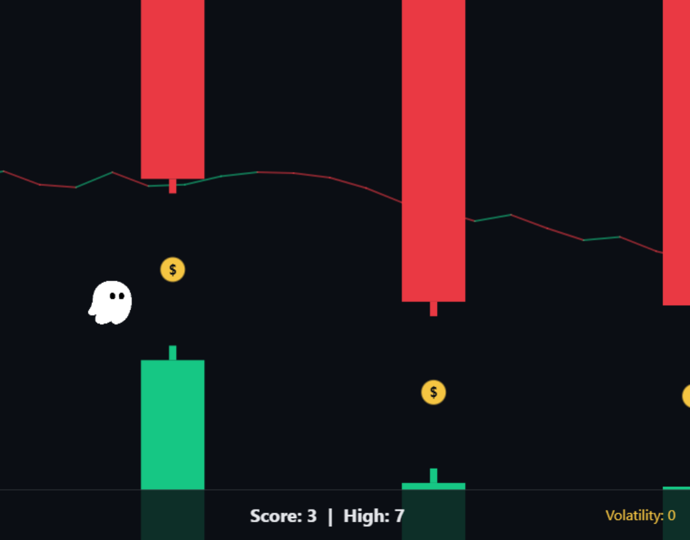

# Flappy Kiro: Trading Edition

A retro, trading-themed endless scroller where **Ghosty** the ghost has to survive the market. Thread through candlestick obstacles, grab gold coins for bonus profit, and hang on as market volatility rises — one mistake and your portfolio is wiped out.

## Demo

Watch a short gameplay demo: **[Flappy Kiro demo video](https://www.awesomescreenshot.com/video/57908934?key=6cbc4dbbe8651f1d6187350f3cba49bd)**

## Features

- **Candlestick obstacles** — green and red candlesticks (body + wick) scroll in from the right.
- **Gold coins** — collect one for a **+5 profit** bonus.
- **Live stock-chart background** — a procedurally generated, continuously scrolling price chart.
- **Rising market volatility** — every 10 points the market speeds up and the gaps tighten, so no two runs feel the same.
- **"Portfolio wiped out"** — a game-over screen showing your final profit and all-time best.
- **Persistent high score** — your best run is saved in `localStorage` and survives a browser restart.

## How to Play

- **Space**, **click**, or **tap** to make Ghosty jump.
- Gravity constantly pulls Ghosty down — tap to stay airborne.
- Fly through the gaps between candlesticks. Each gap passed is **+1 profit**.
- Hitting a candlestick, the ceiling, or the ground ends the run.

## How to Run

No install, no build step, no server. Just **open `index.html` in any modern browser** (double-click the file). The game runs entirely from the `file://` protocol.

## How It Was Built

Flappy Kiro was built with **Kiro's spec-driven development** workflow. The full specification lives in [`.kiro/specs/flappy-kiro`](.kiro/specs/flappy-kiro):

- **`requirements.md`** — user stories and EARS-style acceptance criteria.
- **`design.md`** — architecture, data models, the game loop, and correctness properties.
- **`tasks.md`** — the incremental implementation plan.

The game was implemented task by task against that spec, keeping a clean split between a pure logic core (physics, collision, scoring, difficulty, chart) and the IO layer (input, rendering, audio, storage).

## Tech Stack

Plain **HTML**, **CSS**, and **JavaScript** with an **HTML5 canvas** — no frameworks, no dependencies, no build tools. Everything ships in a single self-contained `index.html` plus the `assets/` folder.

